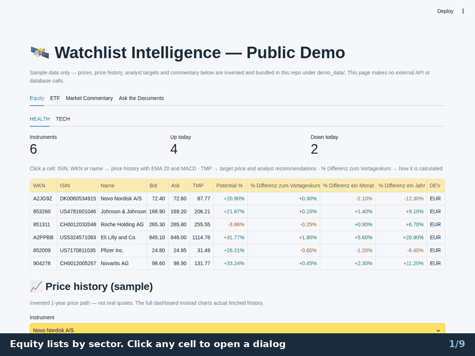
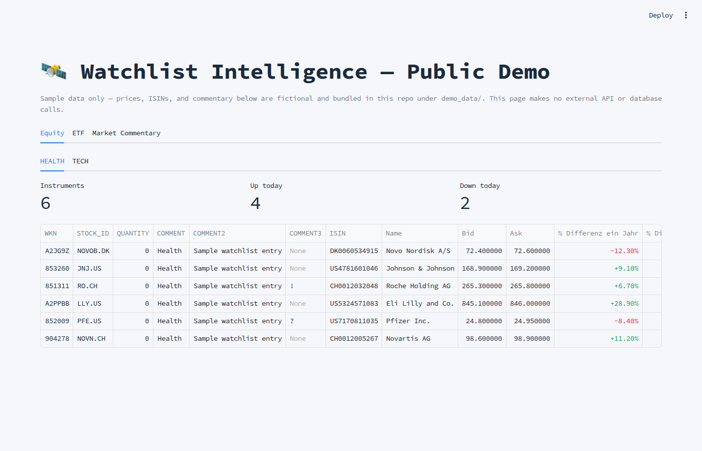
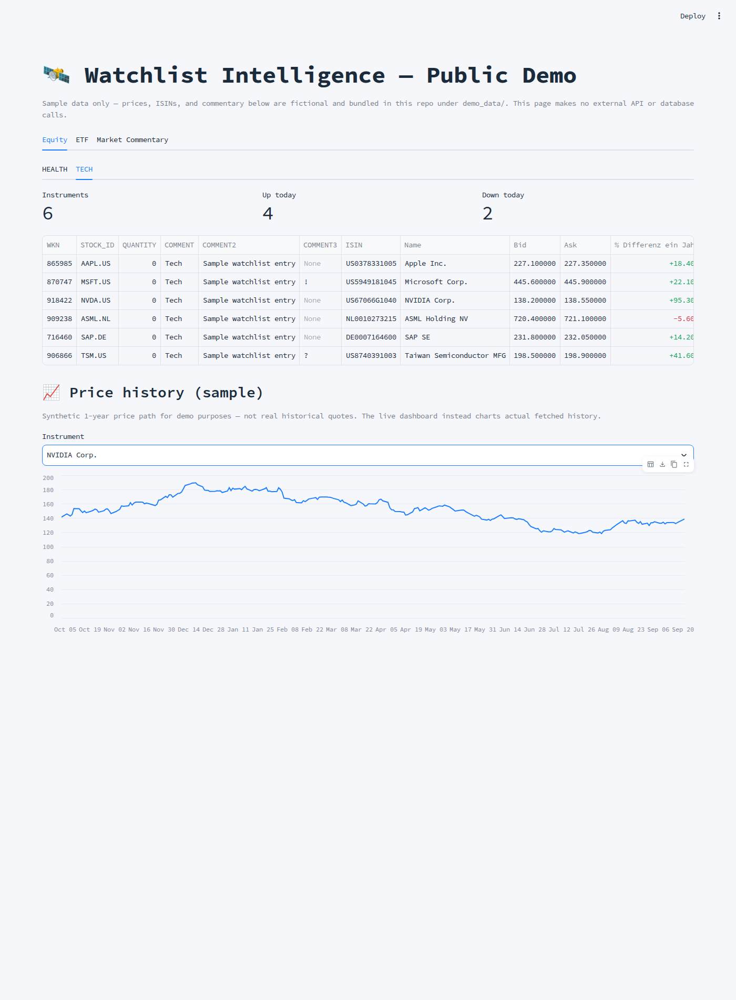
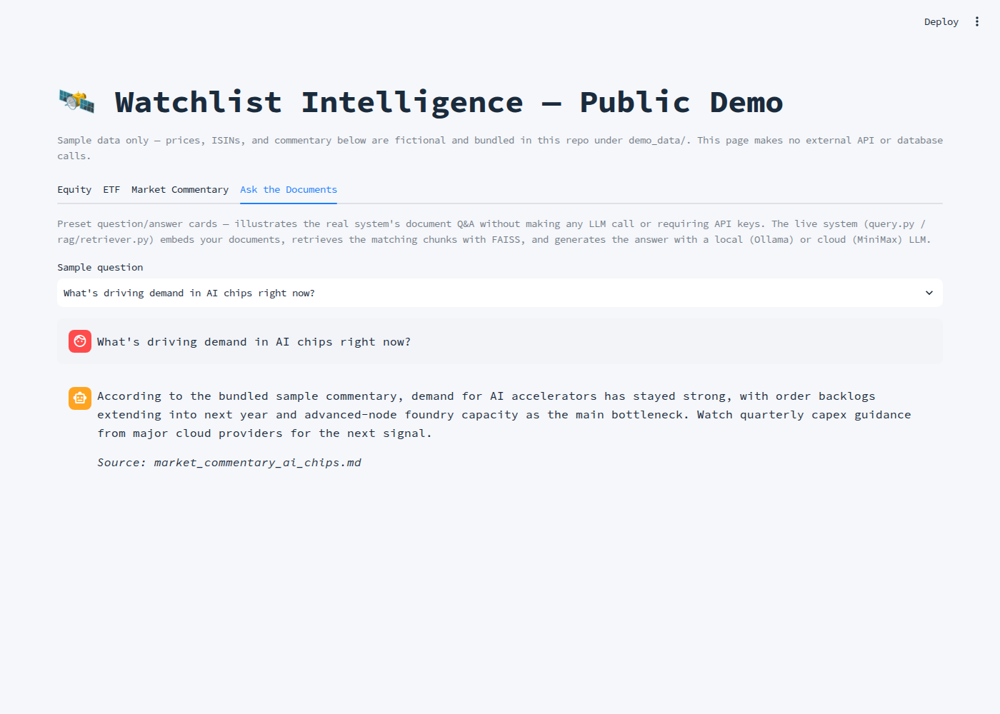

# Financial RAG

**A watchlist dashboard with a document question-answering assistant.** Equity, ETF, index and top-list tables with live quotes and analyst target prices, 1-year price history, and a RAG agent that answers from your own newsletters, PDFs and market data.



## Try the demo

One self-contained [Streamlit page](demo/dashboard_demo.py) on the sample files in `demo_data/`: **no login, no API keys, no database, no network call**.

```sh
pip install -r demo/requirements.txt
streamlit run demo/dashboard_demo.py      # opens http://localhost:8501
```

- **Equity, ETF**: lists by sector with up / down counters and colour-coded changes. Click a cell: an ISIN, WKN or name opens the price history with **EMA 20** and **MACD** switches, **TMP** the price-target and analyst-recommendation charts, the day change how it is calculated.
- **Market Commentary, Ask the Documents**: sample notes and preset question and answer cards (**prewritten, no model is called**).

All numbers are invented: prices, history, targets, recommendations and commentary. The charts and dialogs are the full dashboard's own modules fed with them (`demo/synthetic.py`). To host it, point [Streamlit Community Cloud](https://streamlit.io/cloud) at `demo/dashboard_demo.py` with `demo/requirements.txt`; it needs no secrets.

<details>
<summary>More screenshots</summary>





</details>

## What is in it

| Part | What it does | Where |
|---|---|---|
| **RAG pipeline** | Ingests e-mails, PDFs and market data into a FAISS index and answers questions from them, from the command line and the dashboard chat. [How it works](#how-the-rag-works). | `main.py`, `query.py`, `rag/`, `ingestion/`, `processing/` |
| **Watchlist pipeline** | Enriches ActiveTrader watchlist exports: analyst target (`TMP`) and `Kurspotential`, onvista Bid/Ask, 1-day, 1-month and 1-year changes, a MACD / Stochastic signal, subcategory tags. Also the finanzen.net Top/Flop lists and eight index lists. | `csv_analyse_watchlist.py`, `fetch_finanzen_topflop.py`, `fetch_dax40.py`, `refresh_targets.py` |
| **Server and dashboard** | PostgreSQL, a FastAPI service and a Streamlit dashboard in Docker Compose, with automatic backups and an optional Cloudflare Tunnel behind Cloudflare Access. | `server_app/`, `docker-compose.yml`, `ops/` |

```text
e-mails, PDFs, market data
   -> parse + chunk -> embeddings -> FAISS index -> query.py (pipeline RAG, --agent)
                                                 -> dashboard chat

ActiveTrader CSV -> csv_analyse_watchlist.py -> csv_update/
   -> PostgreSQL -> FastAPI -> Streamlit dashboard
```

## How the RAG works

E-mails and PDFs are chunked and embedded into a FAISS index. Every chunk keeps its metadata (file and page, or e-mail subject and date), which is what the answers cite, for example `[PDF] file Page 2`. A search combines BM25 and FAISS and reranks the hits with a cross-encoder. `query.py` answers in one of two ways.

**Pipeline RAG** (default): retrieve the passages, pick a model, generate, check the numbers. The model is the local one (Ollama), or the cloud model (MiniMax) when the best hit is weak, the question is on the cloud-keyword list (investment advice, say) or the local model takes too long. The prompt carries the passages, live market context and the conversation. [Details](docs/reference.md#pipeline-rag-flow).

**Agentic RAG** (`--agent`): a state machine instead of a single pass.

```text
question -> router: document | market | both | chitchat
         -> document agent and / or market agent, each in its own tool loop
         -> critic: complete, or a follow-up question back to one agent
         -> merge (only if both agents contributed) -> answer -> grounding check
```

- The **document agent** searches and reads the indexed e-mails and PDFs and the watchlists (`search_documents`, `read_file`, `read_email`, `search_watchlist`, `get_watchlist`, ...); each search is graded for relevance before the agent may answer.
- The **market agent** gets live data (`get_market_quote`, `get_instrument_profile`, `get_price_history`, `get_company_news`, `get_news_sentiment`).
- The router and the grader are small local models that must answer in a fixed JSON schema, and fall back to MiniMax on a timeout or an invalid answer. The critic runs on MiniMax first and is skipped when it would add nothing (one specialist, a plain answer).
- Tool calls are plain prompt and regex, not native function calling, and every loop is bounded: at most 4 to 8 rounds, then an `[Incomplete]` reply instead of a forced answer.

[Agentic RAG flow](docs/reference.md#agentic-rag-flow), [market tools](docs/reference.md#new-marketagent-tools).

**Built to be checked**

- **Numbers are checked against the evidence.** After every answer, each percentage, decimal, date and year is looked up in what the model actually saw (the raw tool output, or the retrieved passages), allowing for rounding: `165.543` supports `165.54`. What is not found is listed under the answer ("Not found in the retrieved sources, please verify"); the check only reports and does not edit the answer. It is a rule-based heuristic and cannot tell a number attached to the wrong company. [Details](docs/reference.md#post-processing-numeric-grounding-check).
- **A date in the question filters the search.** "Today's newsletter about the DAX" only looks at documents dated today, for BM25 and FAISS alike, before ranking. If there is none, the agent says so and names the newest date. [Details](docs/reference.md#date-aware-document-search).

## Quick start

```sh
# CUDA Torch if an NVIDIA GPU is found, CPU-only Torch otherwise, then requirements.txt
./scripts/install_requirements.sh

mkdir -p ~/.config/financial_rag
cp config.yaml.example ~/.config/financial_rag/config.yaml    # add your own keys
chmod 600 ~/.config/financial_rag/config.yaml
export FIN_RAG_CONFIG=~/.config/financial_rag/config.yaml

# the first run downloads the embedding model set in config.yaml
python main.py      # ingest, then keep running as a scheduler
python query.py     # ask questions; add --agent for the agentic mode
```

The watchlist tools:

```sh
# enrich one ActiveTrader export
python csv_analyse_watchlist.py "csv/my_list.csv" --output-dir csv_update
# Top/Flop of the supported indices
python fetch_finanzen_topflop.py
# one index list
python fetch_dax40.py --indices "Dow Jones" --output-dir /tmp/index_test
```

The dashboard stack ([`ops/stage1.md`](ops/stage1.md)):

```sh
# in .env set POSTGRES_PASSWORD and FIN_RAG_CONFIG (a host path outside the repository)
cp .env.example .env
docker compose up -d postgres postgres-backup stage1-check
# the dashboard is then at http://127.0.0.1:8501
docker compose up -d --build api agent-api dashboard
```

## The dashboard

Six tabs, one per folder under `csv_update/`: `TOP_LIST` and `INDEX` (generated, read-only) and `EQUITY`, `ETF`, `BUYLIST`, `DEPOTS` (hand-edited lists: new, add, remove, copy and delete a list or an instrument). [Tabs and list editing](docs/reference.md#dashboard-tabs-and-list-editing), [copying instruments](docs/reference.md#copying-instruments-between-lists).

Click a cell to open a dialog:

- **ISIN, WKN, name**: 1-year price history with EMA 20, MACD and Stochastic ([Price-history chart](docs/reference.md#price-history-chart)).
- **TMP**: the analyst price target with the current price, and the analyst recommendations by month ([Target price dialog](docs/reference.md#target-price-dialog)).
- **% Differenz zum Vortageskurs**: the day change worked out from the previous close and the Ask.

## Scheduled jobs

Server crontab, German local time, weekdays. Details and the cron lines: [Scheduled updates](docs/reference.md#scheduled-updates-on-linux-cron).

| Job | When | Script |
|---|---|---|
| Ingestion: e-mails, local PDFs, market data | e.g. e-mails at 08:30, 13:30 and 18:30, local PDFs every 30 minutes | `main.py` (systemd user service) |
| Top/Flop fetch and import | 09:33, 09:53, then `:13 :33 :53` until 22:59 | `scripts/run_finanzen_topflop_update.sh` |
| Top list Bid/Ask | `:07 :17 ... :57`, 09:07 to 22:57 | `refresh_toplist_bid_ask.py` |
| All index lists | `:09` of every hour, 09:00 to 22:59 | `scripts/run_index_update.sh` |
| Analyst target cache (`TMP`) | 10:00 and 16:30 | `scripts/run_target_refresh.sh` |
| Equity lists | full run 08:10 and 15:40, Bid/Ask every 6 minutes | `csv_analyse_watchlist.py` |

## Documentation

- **[Full reference](docs/reference.md)**: every script, option and column, the RAG flows, scheduled jobs, runtime notes and known errors. Good starting points: [Server MVP](docs/reference.md#server-mvp), [RAG workflow](docs/reference.md#workflow), [Agentic RAG flow](docs/reference.md#agentic-rag-flow), [Numeric grounding check](docs/reference.md#post-processing-numeric-grounding-check), [Watchlist processor](docs/reference.md#watchlist-processor), [Top/Flop columns](docs/reference.md#column-reference-sources-and-formulas), [Bid/Ask guards](docs/reference.md#bidask-guards), [Runtime notes and known errors](docs/reference.md#runtime-notes-and-known-errors).
- [Design issues and solutions](docs/design_issues_and_solutions.md): what went wrong, why, and how it was fixed.
- [`ops/stage1.md`](ops/stage1.md): the server's first stage, with backups and the Cloudflare Tunnel.
